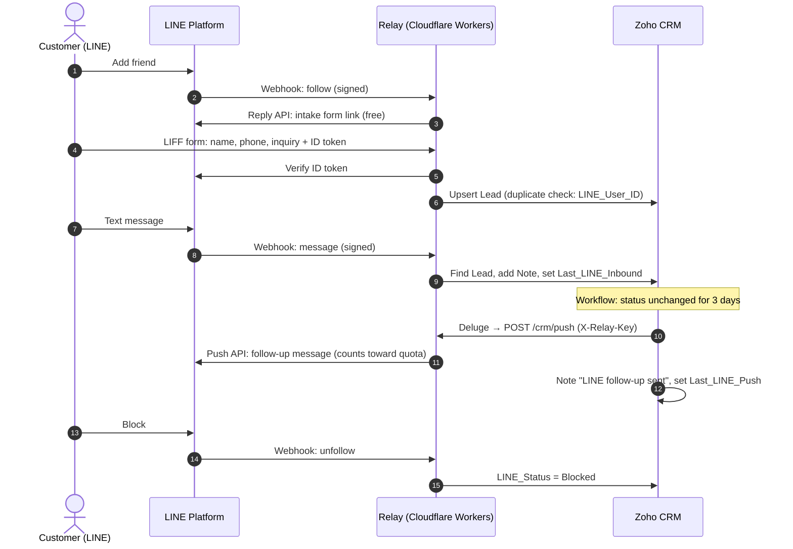

# LINE Official Account × Zoho CRM: lead capture and follow-up

An implementation pattern for small businesses whose customers reach them on LINE.
LINE stays the customer-facing channel. Zoho CRM keeps the record and decides when to follow up.
A small relay on Cloudflare Workers connects the two.

[日本語は下にあります](#日本語)

## What it does

1. **Friend added** → the relay replies with a link to an intake form that opens inside LINE (LIFF).
2. **Form submitted** → the relay verifies the LINE ID token and upserts a Lead, keyed by the LINE user ID.
3. **Customer messages** → the relay adds the message to the Lead as a Note and stamps the time.
4. **Follow-up** → a Zoho CRM workflow (e.g. 3 days after status "Contacted") runs a Deluge function, which asks the relay to send a LINE push message.
5. **Blocked** → the Lead is marked "Blocked" and drops out of follow-ups.

## Architecture

## Design decisions

| Decision | Why |
| --- | --- |
| LINE secrets live only in the relay | One place to rotate keys. The CRM function only knows the relay URL and a relay key. |
| Verify `x-line-signature` on every webhook | Rejects requests that did not come from LINE. |
| Answer the webhook at once, process in the background | LINE recommends asynchronous processing; slow CRM calls must not hold the webhook. |
| Upsert by `LINE_User_ID` (unique field) | Submitting the form twice updates the same Lead instead of creating a duplicate. |
| Reply API for the form link, Push API only for follow-ups | Replies are free; pushes count toward the monthly message quota. |
| Follow-up rules live in Zoho CRM | Sales staff can change timing and conditions without touching code. |

## Files

| Path | What it is |
| --- | --- |
| [relay/](relay/) | Cloudflare Worker (JavaScript, no dependencies). Routes: `POST /line/webhook`, `POST /liff/register`, `POST /crm/push`, `GET /health`. Tests run with `node --test`. |
| [zoho/send_line_followup.dg](zoho/send_line_followup.dg) | Deluge function called by the follow-up workflow. Passes [deluge-lint](../../deluge-lint/) with no findings. |
| [zoho/fields.md](zoho/fields.md) | Custom fields on Leads and the org variables the function reads. |

## Setup outline

1. **LINE**: create a Messaging API channel and a LINE Login channel **under the same provider** — otherwise the user IDs differ between the two and Leads cannot be matched ([LINE Developers](https://developers.line.biz/en/docs/messaging-api/getting-user-ids/)). Add a LIFF app to the Login channel.
2. **Zoho CRM**: add the fields in [zoho/fields.md](zoho/fields.md) (turn on "Do not allow duplicate values" for `LINE_User_ID`), create a Self Client for the refresh token, add the two org variables, and paste the Deluge function.
3. **Relay**: copy `wrangler.jsonc.example` and `.dev.vars.example`, set secrets with `wrangler secret put`, run the tests, deploy, and set the webhook URL in the LINE console to `https://<your-worker>/line/webhook`.
4. **Workflow**: on Leads, a time-based action (e.g. 3 days after `Lead_Status` = "Contacted") that calls `SendLineFollowup` with the Lead ID.

Use your Zoho data center's domains (`.com`, `.eu`, `.jp`, …) for `ZOHO_ACCOUNTS_URL`, `ZOHO_API_DOMAIN`, and the URLs in the Deluge function.

## Limits of this sample

- Webhook de-duplication uses an in-memory set. In production, store `webhookEventId` in KV or D1.
- Assigning the Lead owner, notifying staff, and the intake form's HTML are left to your CRM setup and design.
- `/liff/register` sends no CORS headers. Serve the LIFF page from the same Worker (static assets), or add CORS for the LIFF page's origin.
- Timestamps are written in JST (`+09:00`). Change them if your CRM org uses another time zone.
- It is a starting point, not a drop-in product. Review it against your own security and privacy requirements.

## 日本語

LINE公式アカウントで問い合わせを受ける会社向けの構成例です。LINEは窓口のまま使い、記録と追客のルールはZoho CRMに置きます。間を Cloudflare Workers の小さな中継でつなぎます。

1. 友だち追加 → 中継が受付フォーム（LIFF）のリンクを返信（Reply API。通数に数えない）
2. フォーム送信 → LINEの本人確認の情報を確かめ、LINEのユーザーIDで見込み客を作成・更新（重複しない）
3. お客様のメッセージ → 見込み客のメモに残し、最後に連絡が来た日時を更新
4. 追客 → CRMのワークフロー（例：「連絡済み」のまま3日）が関数を動かし、中継からLINEで連絡（プッシュ。通数に数える）
5. ブロック → 記録を「ブロック」にし、追客を止める

LINEの鍵は中継にだけ置き、通知はすべて署名を確かめます。受付フォームのLINEログインのチャネルと、LINE公式アカウントのMessaging APIのチャネルは、同じプロバイダーの下に作ってください。別だとユーザーIDが一致しません。

仕組みと費用の目安は、ブログ記事【公開後にリンク】にまとめています。

## License

MIT — see [LICENSE](../../LICENSE).
